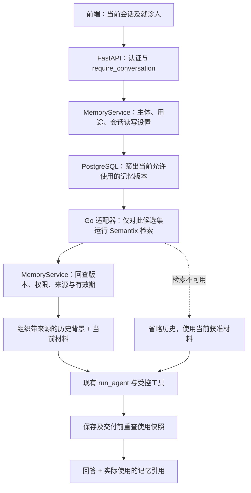

# Semantix 接入设计：按就诊人隔离的跨会话关怀记忆

日期：2026-10-16。状态：设计基线；第一阶段已本地实现与验证，尚未部署。

实现更新：第一阶段已按本方案落地到本地代码；实际实现范围、构建方式和验收入口见 [第一阶段记录](../reviews/patient-memory-phase1.md)。下文保留接入前的调查与分阶段设计，不能用其原始“未实现”描述判断最新代码状态。

本设计基于当前工作区源码和 Semantix 提交 `5e546dcb69b7545e9fba9f95f9464c0ddd6f9cff`。工作区存在大量既有改动，本次只新增设计材料，不修改业务代码。本文不替代 `docs/spec.md`；实现时先同步 REQ-11、用途授权、数据契约与验收用例。

## 1. 建议结论

引入 Semantix 的检索能力，保留 FastAPI、PostgreSQL 和现有聊天 Agent。由业务层管理就诊人、授权、记忆确认、版本和有效期；Semantix 对业务层已经筛选出的记忆排序。第一阶段只进入普通关怀聊天，后续再进入报告生成。

最小隔离边界为 **`owner_actor_id + subject_id`**，同时检查用途、来源会话、就医范围和版本。用户登录账号不是就诊人；同一账号的本人、母亲、孩子分别拥有记忆。同名、同关系和同一设备均不能用于合并身份。不同账号即使有同一主体的访问关系，首期也不共享私有聊天派生记忆。

首期采用 **Python MemoryService + 小型 Go 适配器**。适配器复用 Semantix kernel，通过我们新增的 stdin/stdout JSON 协议调用；上游没有现成的本项目医疗记忆 API。每次只对当前获准的候选集建立临时索引，进程结束即释放。业务数据只在 PostgreSQL 持久化，避免同时建设第二套需要同步撤回的长期记忆文件库。

## 2. 现状核查

- `services/api/sql/021_family_members.sql` 已有 `account_members(actor_id, subject_id)`；`accounts.save_member()` 为新增家人生成独立 UUID。应复用这个 `subject_id`，无需另建平行的 patient_id。
- `conversation_repository.require_conversation()` 从已认证 actor 的会话和案件解析 `subject_id`，并检查访问关系、账号状态和 `case_guidance`。这是后端可信身份入口。
- `search_history()` 已按 actor、subject、来源会话的 recall 开关和有效授权过滤，但用 `ILIKE` 匹配，按时间返回最多 12 条；它是跨会话历史检索，尚非完整长期记忆系统。
- `get_patient_context()` 从最多 20 条来源消息投影自述，上限 12 项 / 6000 字符，以 `(case_id, field)` 去重。它能承接有限自述，但跨案件的同字段可能同时保留，没有统一的长期版本和有效期。
- `source_patient_updates()` 要求保存当前用户消息全文，保留否定与不确定性。这是有价值的来源保护，但一整段话可能同时包含多个时间、人物和事项，不能直接升级为单一患者的长期事实。
- 当前前端 `api.createConversation()` 显式传 `recall_enabled=false`，后端请求模型、仓储函数及 SQL 列默认却为 true。需要统一为关闭默认；既有 true 不能视为新的长期记忆授权。
- 同一个 recall 开关同时影响目标会话是否读历史、来源会话是否被检索，应拆开。单次关怀授权不等于 `continuous_care_memory` 用途授权。
- 显式 `search_history` 有历史 turn 引用登记及回答前复核；自动注入的 `patient_context` 尚无同等统一的记忆使用清单，需要纳入同一套快照和最终核验。
- `release_repository.py`、`repository.py` 和 `material_report.py` 当前保守拦截非空 `memory_refs`。报告端不能只加一段记忆提示词，也不能直接删除这道拦截。

上述是源码观察，不是对所有现有路径的完整安全审计。

## 3. 记什么、属于谁

### 3.1 账号偏好

仅保存明确选择的界面或表达偏好，例如界面语言、字体、回答长度。账号偏好不包含疾病、过敏、用药、就医计划，也不从某位家人的情况自动泛化。首期可继续使用普通账号设置，不必经过 Semantix。

“给妈妈解释得简单一点”属于当前就诊人的沟通偏好；“以后所有回答都简短一点”才可能是账号级偏好。范围不明确时不扩大共享。

### 3.2 就诊人长期记忆

沿用规格中的三种类型：

- `communication_preference`：对该就诊人的沟通方式或明确服务偏好。
- `confirmed_context`：经用户确认、带来源和时间的必要背景。用户确认只证明这是其自述，不等于医学核实。
- `care_plan_ref`：对已发布报告或已确认行动计划的版本化引用，使用时回查源对象；不把计划、处方和整份病历复制成脱离来源的永久摘要。

常见用药、过敏或恢复补充若进入此类记忆，必须保留“自述 / 病历证据 / 已发布计划”的来源区别、否定与不确定性，以及当时的时间和就医范围。模型生成的诊断、建议和回答不得自动成为患者事实。

### 3.3 本次就医与本轮上下文

本次住院、费用争议、复查安排等默认绑定 `case_id`。拒绝长期记忆时，本次授权会话仍可使用其自身近期消息；不写入或检索跨会话记忆。跨次就医只有患者级内容自动参与候选；其他案件的计划须按问题明确检索，并标明原案件和时间。

### 3.4 固定归属与人物歧义

后端从 `conversation_id -> case_id -> subject_id` 解析本轮就诊人，不接受模型输出或请求正文改写 owner / subject。创建会话时的 subject_id 只是选择请求，仍要经访问校验。

切换就诊人应创建或恢复对应会话，不修改旧会话的主体。前端“我的档案”当前选择和 localStorage 不能替代聊天实际归属。迟到响应按 conversation、subject 和请求代次校验后展示。

在本人会话中说“我妈妈也有这个情况”，不能把它记入本人或直接写入母亲档案。首期只为当前明确就诊人生成候选；人物不明、同句话涉及多人或需要跨档案时先澄清、引导切换。代理人是叙述者，患者是信息所指对象，二者分别记录。

## 4. 接入结构与每轮读路径

关键规则：

1. 查询始终使用认证得到的 `actor_id` 和会话解析出的 `subject_id`；不存在全库搜索后再按就诊人隐藏结果的路径。
2. PostgreSQL 先筛 `active`、已确认、当前有效、来源仍可用、用途仍有效及匹配就医范围的版本。候选、撤回、过期和被替代版本不得进入 rank 请求。
3. 适配器每个请求只接收该隔离范围的必要内容和不透明 ID；返回 ID、版本和相关性。`hit` 是相关性分区，不能代表医学事实已验证或访问获授权。
4. 返回结果再从 PG 获取正文，不信任适配器返回的医疗正文、主体标签或授权判断。超时、协议异常、未知 ID、版本不符均丢弃对应结果。
5. 首期仅注入高置信候选，grey 不自动注入；阈值按中文关怀样本校准，不照搬编程任务的 BM25 数值。
6. 当前材料、自述、历史记忆和通用知识分别标记。记忆作为低权威数据放在独立上下文块，不能提供系统指令或获得调用工具的权限。
7. 静态系统规则保持稳定；动态时间和本轮记忆放在动态块。可以优化缓存，但不能为了会话前缀冻结而继续使用已撤回记忆。每次模型调用前和最终保存 / 交付前重新验证使用快照。
8. 如果生成期间记忆被更正、撤回或权限变化，不交付依赖旧记忆的结果；丢弃并在预算内基于有效输入重生成，或明确需要重试。模型调用在数据库事务外执行。
9. MemoryService 的最终核验和状态变更使用共同的版本行 / 锁协议确定提交先后；不持有数据库锁等待模型。已经交给模型或已经送达的内容不能承诺被追回。

首期 top-k、字符预算和调用超时均配置化，并以测量确定；不能把预算默认值当作实际时延或收益证据。

## 5. Semantix 具体复用范围

复用 `kernel/bm25`、需要时的 `kernel/embed` / 融合检索，以及检索分区、预算与可观测性的思路。首期适配器使用 `slice.Index.Insert/Search` 处理已授权列表；所有切片均位于该请求的临时索引中，`scope=project/user` 不承担业务授权职责。

适配器协议是本项目新增边界，建议请求包含协议版本、请求 ID、候选版本列表、问题和检索配置；响应包含同一请求 ID、命中 ID / 版本 / 分数、检索器版本。通过 stdin 传内容、stdout 传严格 JSON，不使用 shell 或把就诊信息放入命令行参数。运行诊断不打印问题、记忆正文或凭证。

固定上游提交和构建产物哈希，保留 MIT 声明。Go 适配器放在独立源码目录，通过固定源码依赖或 vendoring 构建，不假定上游模块已经提供可直接安装的医疗 SDK。后续确有性能需求时，保持同一协议改为内部常驻服务，并增加服务身份校验；不是首期必需。

当前上游 `slice.Scope` 只有 session / project / user；`Index.Search()` 也没有 actor / patient 授权参数。`ProjectSlug` 是元数据，不能作为租户隔离证明。`harness/memory` 的 SubjectKey 表示 `project.package_manager` 一类知识字段，同样不是患者身份。

不使用开发助手的 `%USERPROFILE%/.semantix/user.db`，不读取用户主目录的 AGENTS / MEMORY 文件，不把产品材料放入开发记忆。首期不向上游通用 `extract` 直接喂整段医患聊天，而由业务层提炼、绑定来源、经确认后交给检索。

不把所有模型调用直接切到通用 Semantix gateway：透明代理缺少本系统的患者、用途与报告审批上下文。首期也关闭个性化医疗回答的 L3 直接复用、工具行为自动学习和推测操作。公开静态知识的缓存可在后续单独验证。

默认哈希向量不等于模型语义嵌入；BM25 / 哈希 / 经批准的模型嵌入须分别计量。语义模型的部署和数据流经过现有模型配置与用途校验，中文同义表达的改善用本项目数据证明。

## 6. 业务记忆生命周期与数据设计

### 6.1 建议新增的数据对象

- `care_memory_candidates`：待确认内容、来源 turn / 报告版本、原文定位、owner、subject、case、类型及待确认 / 确认 / 拒绝状态。候选不进入长期检索。
- `care_memories`：稳定 memory_id、owner_actor_id、subject_id、patient / case 范围、可选 case_id、kind、当前版本及 active / revoked / expired / superseded 状态。
- `care_memory_versions`：不可变内容或源对象引用、field_key、来源与 assertion、发生 / 生效时间、记录时间、有效期、确认人和时间、用途授权版本、被替代关系。
- `patient_memory_settings`：每个 actor + subject 的长期用途 / 功能设置和 policy_epoch。历史版本和索引缓存不得绕过当前 epoch。
- `conversation_memory_settings`：分别记录本会话允许读入长期记忆、允许成为长期候选来源。与当前会话近期上下文分开。
- `chat_memory_refs`：回答 turn 实际使用的 memory_id + version、来源版本、授权快照与用途。不在一般运行日志记录正文。

对 `(owner_actor_id, subject_id)` 建业务外键；case 级记忆还必须校验 case 的 subject 一致。源 turn 所属的 actor / subject 也须与候选一致。结构化契约仍以 Pydantic 为单一可执行源。

首期临时索引无需持久化同步队列。后续如增加缓存索引，再用 PG outbox 记录 memory_id、版本、操作和 namespace epoch；异步 upsert 必须验证最新状态，不能在撤回后将过时任务重新写入。所有索引均是可重建派生物。

### 6.2 写入流程

用户的普通消息 → 判断明确所指就诊人和信息类型 → 保留最小必要内容及原文定位 → 生成候选 → 用户确认具体内容与范围 → 短事务保存有效记忆版本。

“请记住……”或明确的纠正请求可以作为确认动作；否则使用合并确认卡，显示“为哪位就诊人记住什么”，可修改或拒绝，避免每条消息都弹窗。模型置信度、Semantix origin 或 judge 通过不能代替用户确认。

没有长期用途授权时，不把普通聊天后台积累为跨会话候选库；当前授权会话仍可使用本轮信息。既往对话不批量自动转为有效记忆；只有来源仍获准、用户选择并确认的内容才迁入。

### 6.3 冲突、时间和更正

沟通偏好一类单值字段可在同 owner + subject + scope + field_key 内版本替代。复查日期默认属于原案件或具体行动。药物、过敏和症状可能多值且有时间范围，不能按字符串相似或“最新记录”简单覆盖全部。

区分 recorded_at 与 effective_at；“昨天停过一次”和“现在已经停用”不是同一事实。保留 present / negated / suspected / historical / unknown，问句、假设和不确定回答不升级为肯定事实。

用户新的更正可以替代其旧自述，但不能改写原病历。新自述与当前材料矛盾时保留双方来源并核对；不能由记忆评分或模型自行决定临床事实。动态用药状态需要明确时效，不能被保存为长期处方。

### 6.4 撤回与删除

先在 PG 使记忆 / 用途状态失效并增加 policy_epoch，所有新调用和晚到结果据此阻断。再处理候选、派生索引、嵌入和缓存；源会话关闭导出时，依赖该来源的派生记忆也停止使用。

关闭目标会话读入只影响目标；撤回长期用途阻止跨会话读写，但不自动取消仍获准的本次关怀。若撤回源材料用途，即使长期用途仍开着也不能继续使用源引用。重新授权不自动复活旧记忆，需要重新确认。

“不再使用”“检索副本清理”“内容物理清理”分别展示。源聊天、审计和备份的保留按既有政策单独处理；撤回记忆不宣称删除已经发送的内容。

## 7. 前端与接口建议

在每个就诊人档案下提供“关怀记忆”，展示内容、来源时间、就医范围、有效性、编辑 / 撤回及用途设置。“我的家人”和“当前对话所属”继续使用既有身份，不出现另一个姓名相同但 ID 不同的记忆档案。

以下为拟新增契约，不是现有 API：

- `GET /v1/me/members/{subject_id}/memories`：查看该账号对该就诊人的记忆。
- `POST /v1/me/members/{subject_id}/memory-candidates/{id}/confirm`：确认候选或显式记忆请求；expected_version + Idempotency-Key。
- `PATCH /v1/me/members/{subject_id}/memories/{id}`：更正并新增版本，不直接覆盖历史。
- `DELETE /v1/me/members/{subject_id}/memories/{id}`：停止使用并返回清理状态，重复请求幂等；不将逻辑撤回伪装成已物理删除。
- `GET/PATCH /v1/me/members/{subject_id}/memory-settings`：按就诊人管理功能设置；长期用途沿用并扩展现有 consent 体系。
- `PATCH /v1/conversations/{id}/memory-settings`：分别控制读入与候选来源。

每个路由都从 session 获取 actor，subject_id 和 memory_id 必须一起做归属校验。跨账号 / 跨就诊人对象按既有约定返回 404；模型工具不接收任意 owner 或 namespace。

## 8. 具体改造顺序

### 第一阶段：正确的聊天记忆

1. 更新 REQ-11 和接口契约，统一默认关闭；建立来源确认、用途设置、版本与读取模型。
2. 扩展 accounts 的按成员用途授权，保留 `case_guidance` 与 `continuous_care_memory` 独立判断；添加 PG 迁移，编号按实施时真实迁移顺序确定。
3. 新增 `memory_repository.py`、`memory_service.py`、类型契约和 Go rank 适配器。保持业务库先过滤、适配器后排序、业务层最后核验。
4. 普通聊天在 `main.py` 调用 `run_agent()` 前装配记忆，`finish_turn()` 前验证快照；用明确的 memory_refs / source_refs 记录实际使用项。将自动 patient_context 与 search_history 来源核验统一。
5. 保留显式历史查看工具，迁移跨会话自述到新的长期用途门槛；不让旧 `get_patient_context()` 成为关闭新记忆后仍自动读历史的旁路。当前会话自身上下文继续可用。
6. 在普通聊天成功落盘后提炼候选，确认时写有效记忆。分析续答、AI 回答和工具输出不作为用户确认来源。
7. 增加按就诊人的管理入口、确认卡和异步请求归属保护。

### 第二阶段：报告与持续关怀

完整接入报告输入快照、memory_refs 版本、user_sources、复核和发布重查。同步修改 `worker.py`、`repository.py`、`material_report.py`、`review_repository.py`、`release_repository.py` 及报告工具验证，替换现有“memory_refs 非空即阻断”为逐项验证，而非放宽门槛。

过期、纠错或撤回的记忆所支持的未发布报告需要重新生成 / 复核。已发布版本的可见性按当前用途及更正策略处理，不静默重写历史报告。

### 第三阶段：确认 Semantix 的增益

相同输入、模型配置和预算比较：无跨会话记忆；PG 结构化偏好 / 引用；PG + Semantix 检索。使用冻结的中文合成跨会话样本，包含不同患者相似表述、信息变更及不可复用的问题。

记录跨人误用、来源准确性、冲突处理、重复提问、有效承接、时延和模型实际用量。先满足隔离与事实边界，再看相关性与成本；不把 provider 缓存命中率当作记忆正确率。不证明增益时保留 PG 记忆，Semantix 通过配置关闭。

## 9. 必须覆盖的验收场景

1. 同账号本人、父母、孩子使用同名字段及相似问题，返回和提炼均不串人。
2. 不同账号相同姓名、相同文本，以及对同主体的多个代理账号，私有记忆不串用。
3. 前端篡改 subject_id / memory_id / case_id、模型要求全局 scope、用户正文要求读取另一人，均不能绕过后端。
4. 同一就诊人新会话复用已确认偏好；换一次就医不把旧复查计划当作当前安排。
5. 问句、否定、推测、第三人情况和未知时间不被压成确定事实；新自述与旧来源冲突可追溯。
6. 分别关闭源导出、目标读入和长期用途，验证所有自动与工具路径；当前会话在本次授权有效时仍能继续。
7. 模型等待时撤回或更正，旧输出不保存 / 交付；并发确认、重复请求及陈旧版本不产生重复有效条目。
8. 检索服务停机 / 超时、空库、未知返回 ID、嵌入失败，只降级历史检索，不绕过权限或报告安全检查。
9. 服务重启后记忆来自 PG 恢复；未来增加缓存时验证跨 namespace 键、过时任务和清理状态。
10. 首期记忆不进入报告路径；第二阶段报告生成到发布之间授权 / 记忆变化被阻断。

以上隔离负例必须全部通过，不能用总平均命中率抵消。数据库行为须在独立 PostgreSQL schema 下验收；mock 和其他数据库结果不能替代 PostgreSQL 并发结论。

## 10. 设计评估时的验证记录（历史）

本节保留实现前的评估记录；最新实现与验收结果见 [第一阶段实现](../reviews/patient-memory-phase1.md)。

- `python -m unittest discover -s tests -p test_patient_followup.py -v`：11 项，9 项通过，2 项因未配置独立 PostgreSQL DSN 跳过。
- `python -m unittest discover -s tests -p test_family_members.py -v`：2 项，1 项通过，1 项因未配置独立 PostgreSQL DSN 跳过。
- 合计 10 项现有契约 / 逻辑测试通过，3 项原生数据库测试未执行。这不证明新增记忆方案已实现或患者隔离已通过端到端验收。
- 未安装 Semantix、未创建业务数据或执行迁移、未调用医疗模型、未修改远端系统。

## 11. 上游依据

- [Semantix README](https://github.com/Gnosil/semantix/blob/5e546dcb69b7545e9fba9f95f9464c0ddd6f9cff/README.md)：定位与接入方式；其中成本数字为回放 / 演示口径。
- [Scope 与切片元数据](https://github.com/Gnosil/semantix/blob/5e546dcb69b7545e9fba9f95f9464c0ddd6f9cff/kernel/slice/slice.go)：Scope 不是患者访问控制。
- [Store / Index 接口](https://github.com/Gnosil/semantix/blob/5e546dcb69b7545e9fba9f95f9464c0ddd6f9cff/kernel/slice/store.go)：可复用的检索边界。
- [检索器配置](https://github.com/Gnosil/semantix/blob/5e546dcb69b7545e9fba9f95f9464c0ddd6f9cff/gateway/retriever.go)：BM25、哈希和模型嵌入的区分。
- [注入实现](https://github.com/Gnosil/semantix/blob/5e546dcb69b7545e9fba9f95f9464c0ddd6f9cff/kernel/inject/inject.go)：预算、来源、分区和代码依赖新鲜度机制，不等价于医疗用途授权。
- [知识字段 SubjectKey](https://github.com/Gnosil/semantix/blob/5e546dcb69b7545e9fba9f95f9464c0ddd6f9cff/harness/memory/subject.go)：字段级冲突思路可借鉴，不能当成 patient_id。

