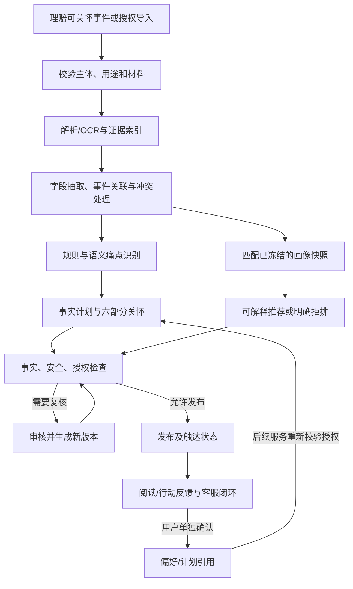

# 众安·暖愈智护 — 产品与系统规格（SDD）

| 项目 | 内容 |
| --- | --- |
| 规格 ID | ZANH-SPEC-001 |
| 版本 | 0.1.0 |
| 日期 | 2026-09-23 |
| 状态 | 可用于拆分设计与验收的规格草案；尚未冻结，不代表已有实现或效果达标 |
| 产品 | 基于理赔医护记录的“医护洞察与温度指引”引擎 |
| 主数据库 | PostgreSQL；开发、集成测试、验收使用相同数据库引擎 |
| 本文范围 | 产品行为、数据与接口契约、质量门槛、验证方式、规格变更流程 |
| 不在本文讨论 | 人员配置、资源协调、日历排期、比赛材料提交安排 |

## 1. 规格依据与解释规则

### 1.1 基线来源

1. 当前会话中用户提供的完整命题、KR1～KR5、验收权重与 AI 原生度红线。
2. 《众安暖愈智护_Agent协同开发详细执行方案_V3.md》，2026-09-22；SHA-256：`41F99585D3B0CE594557652472B59F8B86D96B1DC32726543BD0A43BD361C508`。
3. 《众安暖愈智护_Agent任务派发与验收手册.md》；SHA-256：`AF0DBB55F17998D4C8ACA3A038DE75506DED33AE1297C37958C1E89CD62EC78C`。
4. 本次讨论沿用 PG 为主业务库；质量审查补充事件关联、逐标签有效性、病例差异驱动的个性化、画像可比性与实体归因、资源系统对接和用途授权。

本规格把已有设计收敛成可测试要求。新增枚举、状态机和接口细节是**本版设计规范**，不表述为官方赛题要求或已经批准的外部接口。外部规则未确定的部分见第 14 节。

### 1.2 规范用语

- **必须 / 不得**：本版强制要求；违反时对应需求不通过。
- **应**：推荐默认做法；偏离需在设计记录中说明等价行为与验证方式。
- **可选**：不计入本版核心通过条件，不能成为主链路必需依赖。
- **官方门槛**：用户提供的赛题指标，不能被内部指标替代。
- **内部质量门槛**：防止整体均值掩盖局部失效的附加条件；不得称为官方规则。
- **未测、失败、不适用、不可判定**必须分别记录，不得统一折算成成功。

用户后续明确要求优先于本文件。开发任务不得自行改写规格或放宽验收；先更新相关需求、契约及验收用例，再实现变更。本文不授予生产部署、外部消息发送或真实医疗数据上传权限。

## 2. 产品目标、边界与成功标准

### 2.1 产品目标

以用户已授权使用的理赔材料为事实入口，重建本次医护过程，发现有证据的临床、费用、体验疑点，生成能解释经历、降低理解障碍并支持下一步行动的个性化关怀；依据真实历史数据提供有限度、可解释的医疗资源匹配，并接收反馈。

患者应能回答：发生了什么、哪些内容需要核实、费用如何构成、下一步可以做什么、推荐依据是什么，以及资料被如何使用。

### 2.2 五项官方 KR

| KR | 必须覆盖的结果 | 官方通过条件 | 验证证据 |
| --- | --- | --- | --- |
| KR1 | 诊断、手术、用药、住院天数、费用构成；医疗事件重建 | 关键字段 F1 ≥ 0.90；缺失率 < 5%；符合预定义 JSON Schema；字段级置信度 | 固定数据集、逐字段预测/标注匹配、Schema 验证、事件及证据结果 |
| KR2 | 临床、费用、体验三类痛点，标签/严重度/证据 | ≥ 5 类具体痛点；与专家标注一致率 ≥ 85% | 固定标签表、逐标签结果、专家标注来源、失败及不可判定统计 |
| KR3 | 个性化六部分关怀 | ≥ 3 病种；真人盲评温度感、可行动性分别平均 ≥ 4/5 | 随机盲评记录、量表、病例级汇总、医学事实与安全审核 |
| KR4 | 医院/医生/治疗方案画像与匹配 | ≥ 5 维；每个推荐 ≥ 2 条解释；≥ 3 病种，每病种 ≥ 5 家机构 | 画像公式、数据快照、有效覆盖矩阵、推荐理由与限制 |
| KR5 | 理赔触发至反馈的完整链路 | 原型可演示；含三类系统对接方式、授权与合规路径 | 端到端运行、接口契约、事件记录、数据用途与处理说明 |

V3 的 F1 ≥ 0.94、缺失率 ≤ 3%、痛点一致率 ≥ 90%、两项盲评分别 ≥ 4.5 是内部争取目标，不能与官方达标线混写。

机构在不同病种下能否重复计数、三类画像实体各自需达到何种覆盖、缺失率与一致率精确定义，均保留待确认状态。不得自行宣称必须是 15 家互不相同机构，也不得自行用三个病种共五家机构的名单证明全部达标。

### 2.3 本版核心范围

- 多格式医疗材料导入、OCR/文本解析、字段抽取、事件归并、原文证据定位。
- 三类痛点及专业复核、六部分关怀、最多三项优先行动。
- 数据化画像、可解释匹配、不可比较/数据不足时的明确拒排。
- 案件授权、主体隔离、报告版本、反馈、用途撤回及审计。
- 一次经用户确认的偏好/计划保存，以及后续服务承接；拒绝长期记忆不影响单次已授权关怀。
- 理赔事件、客服工单、医疗资源系统的契约与可运行模拟适配；触达与反馈状态可追踪。
- 自动评测、真人盲评与故障/边界验证。

不以本系统代替诊断、处方或医生诊疗决策；不得据此自动改变理赔结论、要求用户停换药、宣称机构绝对优劣或自动预约。微服务、图数据库、模型训练、真实短信/企微发送不属于本版必需实现。

保留 Semantix 的适配验证与对照设计，但它不决定事实、权限或报告放行。连续关怀必须能在记忆检索服务不可用时降级运行；未证实的内核能力不得写成产品已有能力。

## 3. 用户、用例与主链路

### 3.1 角色

| 角色 | 允许行为 | 明确限制 |
| --- | --- | --- |
| 患者/依法授权的代理人 | 查看获授权案件及已发布报告、提交反馈、管理本人用途授权与记忆 | 不得审批医学复核或自行指定他人身份获取数据 |
| 医学审核人员 | 在授权案件范围查看证据、确认/修改/驳回疑点与报告 | 审核角色不自动获得所有患者数据 |
| 客服人员 | 处理获分配工单，查看必要且获授权的信息 | 不得把客服处理意见改写成医学事实 |
| 评测执行者 | 在受控环境运行冻结候选与指定数据，导出获准结果 | 不在评测过程中调参或将隐藏标签提供给开发者 |
| 系统适配服务 | 按服务身份和事件范围调用指定接口 | 不以患者请求体中的主体 ID 代替认证授权 |

用户、主体、案件三个概念分开：登录账号不必等于患者；代理访问必须有明确的主体授权关系。

### 3.2 主链路



画像快照的批量计算是独立作业，不要求每处理一个新病例重算全量画像。当前病例不得污染用于评价该病例的历史基准。

### 3.3 需求清单

| ID | 可观察行为 | 对应 KR |
| --- | --- | --- |
| REQ-01 | 有效授权后才能登记和处理材料；非法或重复输入有明确结果 | KR5 |
| REQ-02 | 文档输出页级/文本级证据，未知与不可读有状态 | KR1 |
| REQ-03 | 五类字段保留原值、规范值、状态、置信度及来源 | KR1 |
| REQ-04 | 事件正确归属患者、本次就医和治疗阶段；冲突不静默覆盖 | KR1 |
| REQ-05 | 三类痛点使用固定标签，输出严重度、支持证据和动作 | KR2 |
| REQ-06 | 风险内容进入复核，修改有版本且不能覆盖自动成绩 | KR2、KR3 |
| REQ-07 | 六部分报告与优先行动锚定当前事实和明确关注点 | KR3 |
| REQ-08 | 每项画像能复算，实体归因明确，缺失不补分 | KR4 |
| REQ-09 | 可比较才排序；每个推荐至少两条独立有效依据 | KR4 |
| REQ-10 | 反馈关联主体、报告和行动，纠错进入复核 | KR5 |
| REQ-11 | 记忆经确认、可撤回、更正、过期，跨主体不可见 | KR3、KR5 |
| REQ-12 | 三类外部系统按契约对接，事件幂等且触达可追踪 | KR5 |
| REQ-13 | 运行可恢复，失败可见，真实模型与合成/回放可区分 | KR1～KR5 |
| REQ-14 | 固定版本评测与独立质量门槛能决定通过或失败 | KR1～KR5 |

## 4. 技术边界与工程约定

### 4.1 默认实现结构

沿用 React + TypeScript、FastAPI + Pydantic、PostgreSQL。Pydantic 为可执行契约唯一源，导出 JSON Schema、OpenAPI 和前端类型。本文是行为与语义规格，不能与代码中的第二套手写 Schema 长期并存。

第一版采用一个 API 服务、数据库任务表和一个工作进程。任务队列不依赖 HTTP 请求持续存活；进度通过轮询查询。只保留实际使用的模型、OCR、记忆和系统适配边界，不引入复杂运行时多智能体框架。

### 4.2 存储职责

| 数据 | 存储与约束 |
| --- | --- |
| 主体、案件、用途授权、任务、审核、反馈、版本关系 | PostgreSQL 关系表；使用外键、唯一约束及受控状态转换 |
| 字段值、模型结构化产物、事实计划、可变指标明细 | PG JSONB；写入前通过对应版本 Schema；不得用一个无约束大 JSON 替代关键关系 |
| 原始 PDF/图片及受控解析产物 | 受控文件存储；PG 保存存储引用、哈希、版本与所属案件；路径不直接暴露给客户端 |
| 医学知识与规则 | 获准、审核、版本化的知识包；运行无需临时检索未批准的外部来源 |
| 历史机构统计 | PG 中可复算、不可变的画像快照；保存数据来源与截止时间 |
| 可选检索索引 | 业务库的派生索引；不作为身份、授权、撤回状态或医学事实的权威来源 |

### 4.3 事务不变量

1. OCR、LLM 和外部 HTTP 调用必须在数据库事务外执行；读取输入快照后调用，写回时检查快照与授权版本。
2. 同一案件的变更以短事务、行锁或条件更新协调。任何一种实现都必须通过撤回与发布并发测试，不能仅“写了锁代码”即算通过。
3. `Idempotency-Key` 按主体/服务身份及操作作用域唯一；同键同载荷返回既有结果，同键异载荷返回冲突。
4. 报告版本、有效审核结论和待发送记录应在同一短事务中提交；发送前再次检查用途授权、报告状态和版本。
5. 对接侧没有幂等支持时不得声称严格一次发送；保留事件 ID、尝试记录与重复风险。模拟适配器必须实现幂等以便验证。
6. 任务有租约/心跳及重试上限；进程重启可回收过期占用。回收不能让旧执行者覆盖新执行者结果。
7. 已发布报告不可原地改写；纠错产生新版本，原版标记被替代或失效。

## 5. 通用数据语义

### 5.1 基础类型

- 内部标识统一使用 UUID；外部主体、案件、机构、医生标识经带命名空间的映射表关联，不按显示姓名关联。
- JSON 字段使用 `snake_case`；字符串不得以空串冒充缺失值。列表为空与未执行需另有状态区别。
- 系统时间为带时区的 RFC 3339 时间戳，持久化统一 UTC；临床日期保留原文、时区或本地日期语义及精度，不补造时分秒。
- 金额以 `amount_minor: integer` 和 `currency` 表示；人民币单位为分。展示时转换为元。其他币种不得无汇率来源混算。
- 剂量及其他精确十进制值用规范十进制字符串和单位，避免二进制浮点引入误差。
- 每个结果携带 `schema_version`。`confidence_score` 在 `[0,1]` 或为 `null`；后者表示未产生可用分数，不等于零置信度。
- `data_origin = official_deidentified | authorized_historical | synthetic`；`execution_mode = live | mock | replay`。两者独立记录，合成输入真实调用模型仍是 `synthetic + live`。
- 数据来源由服务端核验的导入清单确定；客户端不能靠提交 `official_deidentified` 将样例变成官方数据。执行模式由实际运行路径确定，不能由前端自报成功模式。

### 5.2 事实字段 FieldValue<T>

| 字段 | 类型/条件 | 语义 |
| --- | --- | --- |
| `field_id` | UUID | 字段级稳定引用 |
| `value` | T 或 null | 归一化值；冲突未决或不可读等状态不填猜测值 |
| `raw_value` | string 或 null | 可取得的原文表示 |
| `status` | observed / derived / missing / unreadable / conflict / not_applicable | 事实可用状态 |
| `evidence_ids` | UUID[] | 当前字段直接来源；不得跨案件引用 |
| `confidence_score` | number 或 null | 分数，不自动解释为正确概率 |
| `confidence_method` | string 或 null | 方法及版本；存在分数时必须存在 |
| `unit` | string 或 null | 有单位的值必须填写 |
| `derivation` | object 或 null | derived 时包含公式版本、输入字段 ID、输入证据 |
| `alternatives` | FieldCandidate[] | conflict 时至少两个有来源的候选；其他状态为空 |
| `missing_reason` | string 或 null | 区分未记载、缺少材料、抽取失败等原因 |

临床实体另外保存 `assertion = present | negated | suspected | historical | unknown`。否认既往史是带否定语义的观察，不是 `missing`；没有手术记录不自动等于确定“未手术”。`not_applicable` 必须有明确的适用性判断依据。

### 5.3 证据 Evidence

必需字段：`evidence_id, case_id, document_id, document_version, page_index, text_span, bbox, extraction_method, source_hash, parser_version`。

- `page_index` 为从 0 开始的页号；无分页文本可为 null。
- `text_span` 为 `{start, end, text, offset_unit}`，范围左闭右开；`offset_unit=unicode_code_point`，相对指定版本的页文本或全文文本。前端需处理 JavaScript UTF-16 索引差异。
- `bbox` 为 `[x0,y0,x1,y1]`，左上角原点，坐标归一到 `[0,1]`；无几何来源时为 null。旋转/OCR 坐标需映射回所展示原页。
- `source_hash` 指向对应原始文件字节的 SHA-256；文本块另保存内容哈希以校验解析版本。
- evidence ID 存在不代表支持结论。引用存在性、定位正确性、语义支持分别验证。
- 文档更新产生新版本及对应证据；旧报告继续引用旧版本，不得漂移到新文本。

### 5.4 就医事件与关系

`MedicalEvent` 必须包含：`event_id, case_id, encounter_id, event_type, assertion, occurred_at, time_precision, attributes, evidence_ids, confidence_score, related_event_ids`。

`event_type = diagnosis | admission | discharge | procedure | medication | examination | charge`。`occurred_at` 支持有精度的日期或区间；无法确认时为空。事件关系另用 `{from_event_id, relation_type, to_ref, evidence_ids, status}` 表示，不仅依赖数组顺序。`to_ref={type,id}`，type 为 event / encounter / medication_record / charge_item，避免把就医组或用药属性记录误当成事件 ID。

`time_precision = datetime | day | month | year | interval | unknown`；`occurred_at` 为 `{start, end, timezone}` 或 null，start/end 保留匹配精度的 ISO 日期/时间字符串，不完整日期不得补成一个确定日。关系 `relation_type` 至少包含 `belongs_to_encounter, occurs_before, has_regimen, billed_for`；`status = supported | conflict | indeterminate`。只有时间精度足够时才断言先后，不能把排序显示位置当作医学时间关系。

本版必验关系：诊断与本次住院、手术与时间/住院、药物与剂量/频次/给药途径/疗程、费用与项目/本次结算。只有足够证据时建立关系；相同药名不能据此合并不同阶段用药。一个理赔案件可关联多个就医事件组；`case_id` 不替代 `encounter_id`。

住院天数保存原文值与推导值；推导使用冻结的计日口径。明确记载的天数允许非负小数（例如3.5天），单位固定为day，不截断为整数；区间“3–5天”、负数或不可解析内容不能自动变成单一观察值。原文明确天数与日期差值须区分来源，不通过舍入强行合并。日期不足时不得猜测，冲突时保留来源并复核。模型候选Schema `0.1.1`允许小数数字，规则抽取版本为`evidence-pattern-candidate-v4`。

费用总额、住院天数的规则候选检查同页和跨页全部匹配；不同值进入conflict，同值汇总证据ID。第三条及后续候选必须保留此前所有非空alternative及来源，不得用冲突顶层的null覆盖此前候选，也不得通过重复某一候选自动解决冲突。空白引用、空实体和null alternative均不接受。冲突只表示尚未消解的材料差异，不代表不合理收费；费用口径与就诊归属仍须核查。当前每类型单字段存储尚不能完整表达多诊断、多手术及治疗阶段，本规则不将其宣称为已完成的事件重建。

### 5.5 案件、材料及聚合响应

| 对象 | 最小字段 | 约束 |
| --- | --- | --- |
| Case | case_id、subject_id、external_case_ref、consent_refs、data_origin、user_context、version、created_at | external_case_ref 包含 source_system 与外部 ID；跨系统相同 ID 不合并；user_context 为可空的用户自述/关注点/表达偏好，并标记来源 |
| Document | document_id、case_id、document_version、document_type、media_type、byte_size、page_count、source_hash、source_ref、status、created_at | 内部另存 storage_ref；status 为 registered / parsing / parsed / unreadable / failed；page_count 在未知时为空 |
| Facts | case_id、run_id、schema_version、diagnoses[]、procedures[]、medications[]、hospitalizations[]、expenses[]、completeness | 实体含 ID、encounter_id、assertion、FieldValue 属性；缺失字段不得靠省略键隐藏；数组为空时 completeness 区分无适用项、未发现和未完成处理 |
| Feedback | feedback_id、subject_id、report_id、report_version、action_id、type、text、created_at | 主体和时间由服务端确定；action_id 可空，存在时必须属于该报告 |

药物记录中的名称、剂量、频次、途径、疗程分别为 FieldValue，保留共同 medication ID 与对应事件 ID；费用记录必须含币种、金额口径、所属结算/就医及明细引用。不得只返回五个自由文本段落冒充结构化结果。

### 5.6 输入快照与版本一致性

`input_hash` 由规范化输入快照计算，快照包含文档 ID/版本/哈希、有来源的用户上下文、实际使用的记忆 ID/版本和处理配置版本；不得对不稳定的 JSON 键顺序直接计算不同语义哈希。模型、知识、策略与用途版本另有显式字段，且参与运行去重所用指纹。

用户上下文是自述而非医疗事实；后续反馈改变关注点时产生新的上下文版本。授权或内容快照变化后，旧结果不能覆盖新状态；如果仍可在剩余有效用途内使用，必须重新检查并形成相应版本记录。

## 6. 功能规格

### 6.1 材料、抽取与事件重建（REQ-01～04）

支持文本 PDF、扫描 PDF、图片和受控文本输入。文件类型、大小及页数限制由版本化配置明确给出，越界时返回具体错误。按文件哈希识别重复材料，并在解析后检查近重复页面；同内容出现在不同案件中不得共享未经授权的访问路径。

优先读取可信文本层，扫描页使用 OCR；保留表格行列、页码和来源位置。未知版式仍可登记，但必须给出解析状态；不可读页不得由模型补全成“看起来合理”的文字。

模型抽取使用病例材料、固定字段 Schema 和已批准样例。原始输出、Schema 修复输出与人工修正输出分开存储。模型 JSON 无效可按固定预算修复；仍不合法则失败，不填固定成功结果。

费用至少区分医疗总费用、明细分类、材料明确记载的支付构成。原型费用补充字段为 `cost_breakdown`，含按材料版本/页面或单个证据块限定范围的 `CostField`，保留原文标签、`FieldValue<CostAmount>`、原文quote和引用；子字段冲突需复核。未确认完整性、单据范围和重复分类时，`completeness_status=not_established`、项目求和及自付比例为空；旧运行不得自动回填。医院结算自付、医保外费用、商业保险赔付后的净负担不得混称“自费”；缺少对应结算/赔付证据时不可推算用户最终负担。

### 6.2 痛点识别（REQ-05）

识别过程：确定性核对/统计候选 → 模型语义理解 → 证据与适用性核对 → 去重与冲突处理 → 输出确定状态或复核候选。不得仅规则匹配后填模板完成整个能力。

`Insight` 保留 V3 字段：`insight_id, category, label, severity, confidence, evidence_ids, rationale, uncertainty, suggested_action, review_required, review_status, rule_version`；补充 `case_id, run_id, judgment_status, knowledge_refs`。

- `category = clinical | cost | experience`。
- `severity = low | medium | high | undetermined`；严重度按审核后的标签规则确定，不能由 LLM 自行统一打高风险。
- `judgment_status = candidate | supported | indeterminate | rejected`，表示证据与判断状态。
- `review_status = not_required | pending | approved | corrected | rejected`，表示审核状态；两种状态不能混用。
- 资料未记载不等于医疗行为未发生；费用偏离不等于不合理收费；没有用户自述不能宣称用户实际恐惧、贫困或不满。
- 临床候选不能在患者端表述为已经确定的误诊、错误用药或非必要治疗。

以下六类是**本版候选标签目录**，需映射官方标签并通过医学规则确认后才能作为正式评测标签，不是医学金标准：

| 候选代码 | 类别 | 识别对象与必要限制 |
| --- | --- | --- |
| CLIN_MEDICATION_CONTEXT_REVIEW | clinical | 药物与已知诊疗情境存在需核实线索；缺少适应证材料本身不能认定用药错误 |
| CLIN_EXAM_JUSTIFICATION_REVIEW | clinical | 检查适用性/重复性疑点；必须排除病情变化、时间阶段和合理复查等解释 |
| COST_SELF_PAY_DEVIATION | cost | 明确支付口径下，相对可比病例组的自付比例偏离；无可比基准不可判异常 |
| COST_AMOUNT_RECONCILIATION | cost | 总额与明细或项目计数存在待核对差异；先排除重复页、折扣及结算口径差异 |
| EXP_TERMINOLOGY_BARRIER | experience | 当前记录中的重要术语缺少通俗说明，标为解释需求，不断言患者理解能力 |
| EXP_DISCHARGE_GUIDANCE_GAP | experience | 所提供出院材料相对适用清单存在指引缺项，不声称医生没有口头指导 |

每个正式标签必须具有必要字段、知识来源、排除条件、严重度规则、正例、反例、不可判定例、建议动作及官方标签映射。至少五类有效标签覆盖三大类；不能靠重复命名凑数，也不能用文档完整性标签代替全部临床识别。

### 6.3 复核与放行（REQ-06）

高风险临床结论、证据冲突影响行动、疑似不受支持的医疗建议必须进入复核。审核者看到原文、模型候选、规则依据、冲突与待确认项，并可通过、修改或驳回。

`ReviewDecision = {review_id, target_type, target_id, target_version, decision, reason, corrections}`；审核身份和时间由服务端添加。`decision = approve | correct | reject`。修改必须触发新版本及重新检查；审核通过不代表可以忽略授权撤回。

报告决策通过同一reviews接口处理，必须携带Idempotency-Key；correct的corrections字段允许完整sections或actions替换，逐条验证来源与安全约束。响应的result_report_id定位新版本，review_parent_id保留前版关系，原版内容不原地改写。approve只进入ready，后续发布必须独立通过§7门槛。当前实现范围、验证命令和未完成项见[报告审核链路](reviews/report-workflow.md)。

`corrections` 只允许修改目标版本中获授权的事实/结论，逐项含 `field_or_claim_id, replacement, source_refs, reason`；不得修改主体归属、来源模式、原始文件或既有自动预测记录。目标已有新版时拒绝陈旧决策。

未审风险不能进入已确认患者报告。若要先交付安全内容，必须创建一个独立验证通过的报告版本，明确哪些部分待核实，不得偷偷删除失败内容后沿用原版“完整通过”的状态。

### 6.4 温度指引与行动（REQ-07）

报告固定包含六个 section：`diagnosis_explanation, treatment_review, cost_explanation, recovery_plan, emotional_support, next_visit_advice`。每段可以说明信息不足，但不得用空段占位冒充内容齐全。

生成顺序为：建立病例事实计划 → 引入适用且获准的知识解释 → 根据用户明确表达的关注点和偏好组织语言 → 产生行动 → 检查事实/安全/授权。当前病例、专业知识、患者自述、历史记忆四类来源分别保存。

报告校验失败最多进行一次受限重写，之后仍不通过则转复核或拒绝发布；不能通过无限重试筛出一份成功结果后隐藏失败过程。金额、日期、药名等可确定核对项由代码检查，语义支持和医学边界使用独立预期/审核记录验证，不能仅凭生成模型自称正确。

`Claim = {claim_id, text, claim_type, evidence_refs, knowledge_refs, source_refs, review_status}`。

`claim_type = case_fact | professional_explanation | patient_statement | service_suggestion | to_confirm`。病例事实需证据，专业解释需知识来源，患者自述需反馈/输入引用；安抚语不能假装知道用户没有表达过的感受。

`Report` 必须含 `report_id, case_id, run_id, report_version, status, sections, actions, input_hash, model_id, prompt_version, knowledge_version, policy_version, memory_refs, consent_refs, created_at`。`consent_refs` 为实际使用的 `{consent_id, version, purpose}` 列表，支持一个报告涉及多个用途。所有推荐内容引用明确的推荐快照/结果版本，不能在报告内临时生成机构口碑。

`Action` 保留 `action_id, report_id, source_refs, owner_role, action_text, due_at, due_source, status, feedback_ref`；补充 `priority, rationale`。

原型报告草稿用 `source_quote` 引用已授权 `user_sources`（当前仅 `case:user_context`），与引用病历的 `evidence_quote` 分开绑定。用户担心、偏好和提醒要求不能充当医学事实或医嘱；用户表达的改写及模型生成的服务建议均需复核，不能凭模型自报 `claim_type/review_status` 自动放行。发布按实际内容重算复核要求，需对应报告 ID/版本的真实审批记录，不能依赖保存的空错误列表。当前聊天历史尚未自动冻结到报告用户来源中。

- `owner_role = patient | caregiver | clinician | customer_service`；行动不得替未知主体承诺服务。
- `status = proposed | acknowledged | completed | deferred | help_requested | cancelled`。
- `due_source = medical_order | user_request | service_policy | unknown`。没有时间依据时 `due_at=null`；用户提醒时间不是医学复诊时间。
- 每项优先行动必须绑定病例事实或用户关注点；最多三项优先行动，其余可在详细内容中展示。
- 改变治疗经历、出院医嘱或明确关注点，应改变相关解释/行动；仅改变表达偏好不能改变诊断、剂量、费用或日期。
- 禁止新增处方、虚构康复期限、保证疗效、替用户断言情绪，或把一般知识写成该患者已经发生的事实。

### 6.5 画像与可解释推荐（REQ-08～09）

#### 6.5.1 实体与归因

`entity_type = hospital | doctor | treatment_plan`。医院使用稳定机构映射；医生使用机构命名空间下稳定身份和记录中的角色；治疗方案使用规范化方案定义、适应情境和版本。不得仅按人名、科室名或模糊治疗名称聚合。

医院总体统计不能复制成某医生或方案的品质。涉及多位医生时须有明确归因规则；无法归因的维度标为不可计算。医生与方案的覆盖要求按第 14 节确认，但三种实体的 Schema 与归因测试必须存在。

`ProfileMetric` 保留：`entity_id, entity_type, disease_group, cohort_filters, metric_name, numerator, denominator, value, unit, window_start, window_end, sample_count, missing_rate, computable, limitations, snapshot_id`；补充 `metric_version, dataset_version, comparison_group_id, uncertainty, eligibility_policy_version`。

费用水平补充 `reference_sample_count, reference_eligible_count, reference_missing_rate, reference_median_minor`，参照组与实体均须通过冻结样本和缺失门槛。患者反馈先选该实体分层内每个受访者最新明确归因索引，再检查当前问项与回答，最新缺失不得用旧回答补齐。

非比率指标的 `numerator/denominator` 可为空，但必须由指标字典定义聚合方式；比率分母为零时 `value=null, computable=false`。不可计算值不能写 0。每次统计保留纳入/排除条件及聚合样本数，不公开患者明细作为推荐理由。

#### 6.5.2 候选指标字典

以下为可实现的指标定义方向；是否计入官方五维须以实际字段、医学适用性及官方口径确认，不能为了凑维度把代理指标改名为临床质量。

| 维度 | 计算定义 | 必须披露的边界 |
| --- | --- | --- |
| 同组费用水平 | 当前实体同病种、治疗及风险层病例总费用中位数 / 参照组中位数；参照值为零不可算 | 名称为费用水平；没有疗效数据时不宣称成本效果最优 |
| 自付负担 | 统一结算口径下自付金额合计 / 对应总费用合计 | 医保待遇、结算口径不同不可直接比较；不等于商业险赔付后净负担 |
| 用药规则符合度 | 适用审核规则中符合的判断机会数 / 可判定的适用判断机会数 | 明确所覆盖规则与不可判定比例，不代表所有用药均合理 |
| 治疗规范符合度 | 获审医学标准中符合项 / 可判定适用项 | 不能把记录完整性当实际治疗规范性；需固定标准版本 |
| 出院指引记录完整度 | 适用指引清单中材料明确包含的项 / 该病例适用项，再按规定聚合 | 文档与服务衔接代理指标，不等于疗效或患者实际体验 |
| 再入院情况 | 满足冻结观察窗口、去重及计划性排除规则的再入院病例 / 具备完整观察的索引出院病例 | 追踪不完整不可算；不能把“没有后续理赔记录”直接当“没有再入院” |
| 患者反馈 | 按固定问项、量表和病例去重规则汇总，分别给有效人数及响应率 | 不把未反馈记为满意，也不由病历推断评分 |

指标政策必须规定比较单位、必要分层字段、最小有效样本条件、最大可接受缺失/不确定性及拒排条件；这些数值不可由模型动态决定。未冻结政策时可展示原始描述性统计，但不能开放可信排名或判定 KR4 达标。

#### 6.5.3 匹配行为

候选资格过滤 → 画像有效性检查 → 形成可比较组 → 按固定策略与患者明确需求匹配 → 校验理由 → 返回推荐或拒排。

`Recommendation = {candidate_id, entity_type, eligible, match_reasons, limitations, metric_snapshot_refs, ranking_allowed, rejection_reason, policy_version}`。每条 `match_reason` 包含 `reason_code, text, metric_refs, need_refs`，引用至少两个不同有效依据；同一指标的两种说法不能充数。

本版不定义未经论证的综合医疗质量分。排序策略与权重需在政策中固定；可以依据用户明确选定的偏好对可比维度排序，不能用 LLM 自由评分。缺失指标不按零或均值暗中补齐。

必要风险变量缺失、实体不可归因、观察窗不完整、样本不足或排名对预定义扰动过于敏感时，应拒绝相应比较。删一验证须重查样本、缺失和不可判定门槛（费用含参照组）；所有明确需求和至少五个有效维度均须保留各自有效依据，不能仅检查首选排序维度。仍可给事实性资源列表，明确 `ranking_allowed=false`；此类结果不得冒充有依据的完整推荐覆盖。

输出三病种×机构覆盖矩阵，并分别列出已有记录、画像可计算、可比较、满足两条理由的有效机构数量。五个空雷达轴不算五维画像。

### 6.6 反馈与连续关怀（REQ-10～11）

反馈必须绑定主体、报告版本及可选行动 ID。支持 `understood | unclear | verify_fact | action_done | action_deferred | need_help`；自由文本作为不可信用户输入保存，不自动变为医疗事实或隐藏标签。

事实纠错进入复核；客服协助进入工单；行动状态保存变更记录。不能把“已阅读”当成“理解”，也不能把“工单已关闭”当成健康问题已解决。

`Memory` 保留：`memory_id, subject_id, scope, kind, content_or_ref, source_id, consent_id, consent_version, verified_by, valid_from, expires_at, status, supersedes_id`。

- `kind = communication_preference | care_plan_ref | confirmed_context`；本版默认保存必要偏好与计划引用，不复制整份病历到记忆索引。
- `status = active | revoked | expired | superseded`；写入需用户明确确认来源及用途。
- 检索前、注入前、报告发布前均验证主体、用途、有效期及版本。旧记忆不能覆盖当前病例；冲突需核实。
- 撤回先使权威状态失效，再处理索引、缓存和物理副本。分别记录停止使用、索引清理、物理清理状态，不声称已发送内容被抹除。
- 开发助手全局记忆与产品库隔离；不得用开发记忆保存医疗材料或患者摘要。
- 记忆失败时跳过历史，继续处理当前已授权病例；医学检查或授权验证失败不能使用相同的放行降级逻辑。

连续关怀的质量通过同输入下的无历史、结构化偏好、可选 Semantix 三种策略对照检验，观察计划承接、相关性、重复提问、事实变化和成本；未观察到收益时如实报告。

## 7. 运行、发布与故障状态机（REQ-13）

### 7.1 分析任务 Run

必需字段：`run_id, case_id, input_hash, schema_version, status, current_stage, stage_results, attempt, max_attempts, lease_token, lease_expires_at, error, execution_mode, started_at, finished_at`。内部租约信息不必返回患者端。

| 状态 | 允许后继 | 条件 |
| --- | --- | --- |
| queued | running / cancelled | 有效授权且成功领取任务；撤回或取消可终止 |
| running | waiting_review / completed / failed / cancelled | 按保存的阶段结果推进；异常进入明确状态 |
| waiting_review | running / cancelled / failed | 审核或纠错形成有效输入后从受影响阶段继续；驳回关键内容可终止 |
| failed | queued | 仅可重试错误、预算未超且输入/授权仍有效；保留失败尝试 |
| completed | 无 | 分析产物已保存，不等于报告已发布或已触达 |
| cancelled | 无 | 禁止继续提交结果；再次请求创建新的运行 |

阶段至少包括 `parse, extract, reconcile, insights, guidance, recommend, validate`。各阶段保存输入/输出哈希、版本、状态、起止时间和错误。输入文档变更创建新运行，不覆盖旧运行。语义幂等相同输入运行的策略必须区分“重试既有运行”和“用户明确重新分析”。

### 7.2 报告 Report

`draft → validating → ready | pending_review | rejected`；`pending_review` 经决策后进入 `validating` 或 `rejected`；`ready → published`；`published → superseded | invalidated`。

放行事务必须同时确认：事实/安全检查通过、要求的复核完成、输入与报告版本一致、主体及用途授权有效、使用记忆未撤回/过期。检查不可用时保持未发布状态。模型生成完成不自动触发发布。

已发布版本因纠错被替代时仍可按有效权限查看历史及更正提示；用途撤回后的可见范围按授权政策执行，不能把审计留存权限当患者或客服继续读取权限。

### 7.3 触达与工单

触达记录：`pending → dispatching → sent | failed | cancelled`；`sent → delivered`；阅读和反馈是后续独立事件，不伪造渠道不可提供的回执。发送前用途失效则取消。已经发出的通知无法因撤回而消失，应阻断后续访问与再次发送并记录事实。

工单：`open → in_progress → resolved → closed`；用户仍需协助可重新打开。解决原因、处理者与用户确认状态分别保存；没有用户确认时不得伪称用户确认解决。

### 7.4 故障行为

| 故障 | 必须行为 |
| --- | --- |
| OCR/LLM 超时、限流或无效输出 | 有界重试，记录失败；不切换成固定成功样例 |
| 页面不可读或字段冲突 | 保留局部结果和问题状态；不把整案无声丢出评测 |
| 画像/资源系统无结果 | 明确未推荐或无法获取资源；病例解释流程可继续，KR4 缺口仍记录 |
| 记忆服务不可用 | 不注入历史，披露承接不可用；当前授权分析可继续 |
| 审核、安全或权限检查异常 | 不放行相关报告 |
| 工作进程退出 | 回收过期租约，从安全阶段恢复或明确失败；禁止永久“处理中” |
| 网络不可用切回放 | 用户明确看到 replay 模式、原运行版本和时间，不计入实时模型成功 |

超时、最大尝试数、任务租约与预算须在运行配置中明确且有测试；具体供应方参数见待决项，不默认无限等待或无限重试。

## 8. API 契约

### 8.1 共同行为

- 版本前缀 `/v1`；服务端通过认证上下文确定 actor，逐对象校验主体及案件权限。
- 新建资源一般返回 201；异步运行及异步对接接收返回 202；查询与状态变更成功返回 200。
- 401 表示未认证；跨主体对象访问默认 404，避免暴露对象是否存在；已授权对象上的角色不足为 403；状态/版本/幂等冲突为 409；Schema 错误为 422；大小越界 413；类型不支持 415；限流 429；依赖不可用 503。
- 标准错误为 `{code, message, retryable, trace_id}`；错误信息不得泄露病历正文、他人标识、凭证或文件路径。
- 状态修改接口使用 `Idempotency-Key`。审核、撤回、行动等更新携带 `expected_version`；陈旧版本返回 409。
- 列表接口用 `limit` 与不透明 `cursor`，返回 `{items, next_cursor}`；结果按服务端规定的稳定顺序返回。
- 每个响应包含业务对象的版本或运行来源。生成文件不可手改；OpenAPI 必须包含成功、缺失、冲突、无权限和失败样例。

### 8.2 业务接口

下表保留 V3 路由，补充列表、事件、用途授权和实际行动更新端点。路径是本版拟冻结契约，不代表当前存在。

| 方法与路径 | 请求关键字段 | 响应/副作用 | 权限 |
| --- | --- | --- | --- |
| POST /v1/cases | external_case_ref（可空）、subject_ref、consent_id、source_ref、user_context（可空） | Case；校验代理关系及来源后建立案件 | 患者/合法代理/授权导入服务 |
| GET /v1/cases | limit、cursor | 可访问案件列表 | 当前授权主体 |
| POST /v1/cases/{id}/documents | multipart file、document_type（可空）、source_ref | Document：ID、版本、哈希、状态 | 案件写入权限 |
| GET /v1/cases/{id}/documents/{document_id}/content | version | 受控文件响应；不暴露服务器路径 | 案件证据读取权限 |
| POST /v1/cases/{id}/runs | document_versions[]、pipeline_version、force_new（默认 false） | Run 摘要；202 | 案件处理用途有效 |
| GET /v1/runs/{run_id} | 无 | 状态、阶段、错误及允许读取的产物引用 | 所属案件权限 |
| GET /v1/cases/{id}/facts | run_id | 五类 FieldValue 集合、来源与完整性状态 | 案件权限 |
| GET /v1/cases/{id}/events | run_id | MedicalEvent[] 与关系 | 案件权限 |
| GET /v1/evidence/{id} | 无 | Evidence、受控原页/文本引用 | 同案件证据权限 |
| GET /v1/cases/{id}/insights | run_id | Insight[]；患者端仅返回可见状态的内容 | 按角色过滤 |
| GET /v1/cases/{id}/reports/{version} | 无 | Report；患者只可读允许交付版本 | 按角色与发布状态 |
| POST /v1/cases/{id}/reports/{version}/publish | expected_version；Idempotency-Key | 发布记录与APP待触达ID，delivery_status=pending | 指定审核权限、授权及发布门槛 |
| GET /v1/cases/{id}/recommendations | run_id | 推荐、拒排原因、引用快照及策略版本 | 案件及推荐用途权限 |
| GET /v1/reviews | status、limit、cursor | 获授权复核队列 | 审核角色及案件范围 |
| POST /v1/reviews/{id}/decision | expected_version、decision、reason、corrections | 新决策版本；必要时重建报告 | 指定审核权限 |
| POST /v1/feedback | report_id、report_version、action_id（可空）、type、text（可空） | Feedback；按类型更新行动/产生复核或工单 | 报告对应主体权限 |
| POST /v1/actions/{id}/status | expected_version、status、reason（可空） | 行动状态及审计引用 | 行动对应主体/指定工作人员 |
| POST /v1/me/consents | subject_ref、purposes[]、notice_version、confirmation | 用途授权记录；服务端确认授权关系 | 本人/合法代理 |
| GET /v1/me/consents | subject_ref | 有效与历史授权摘要 | 对应主体 |
| POST /v1/me/consents/{id}/revoke | expected_version、purposes[] | 撤回版本及处理状态 | 对应主体 |
| GET /v1/me/memories | limit、cursor | 本主体记忆及有效状态 | 本人/合法代理 |
| POST /v1/me/memories | source_id、kind、content_or_ref、consent_id、confirmation | 已确认 Memory | 连续关怀用途有效 |
| POST /v1/me/memories/{id}/revoke | expected_version | 停止使用/索引/物理清理状态 | 对应主体 |

`subject_ref` 仅表达希望操作的主体，不授予访问权限。`force_new` 不绕过预算、授权或数据隔离。运行、反馈和审核只能引用同一案件的对象。

错误响应示例（合成、仅用于契约）：

```json
{
  "code": "REPORT_VERSION_CONFLICT",
  "message": "报告已有更新版本，请刷新后重新处理。",
  "retryable": false,
  "trace_id": "ae600f01-23d1-416e-b0aa-b23d55911063"
}
```

此处 retryable=false 表示不能自动重放同一陈旧请求；刷新并构造新请求仍可继续操作。最终 OpenAPI 须按上述类型补齐所有字段类型、必填/null 条件及示例，由可执行契约导出。

### 8.3 三类系统对接（REQ-12）

外部契约使用共同事件头：`event_id, event_type, event_version, occurred_at, source_system, correlation_id, payload`。服务身份认证、签名、时间窗/重放验证方式在适配政策中固定；原型可用明确标记的服务令牌，但不得省略认证测试。

| 系统 | 方向与原型接口 | 关键载荷 | 成功、重复与失败行为 |
| --- | --- | --- | --- |
| 理赔审核 | 入站 POST /v1/integrations/claims/events | 理赔案件映射、主体映射、可关怀状态、材料引用/版本、用途授权引用 | 验证通过持久化后返回 receipt_id；同事件不重复建案/启动；授权不足返回明确状态；关怀结果不回写理赔裁决 |
| 客服工单 | 出站 TicketAdapter.create；入站 POST /v1/integrations/tickets/events | case_id、report_version、协助类型、必要摘要、来源行动；回调 external_ticket_id、状态、处理原因 | 同来源反馈仅建一个工单；回调校验归属和版本；失败可重试且对用户可见；不发送未经授权的完整病历 |
| 医疗资源推荐 | 出站 ResourceAdapter.match | request_id、病种/治疗需求、用户明确约束、目录版本；只传所需信息 | 返回目录版本、稳定机构/医生/方案 ID、资格/服务能力及可追溯来源；超时、空列表和字段缺失分开处理 |

资源适配响应须映射内部实体；没有对应画像快照的候选只能展示基础资源信息。外部返回的营销评价不能作为品质分。机构停用、服务能力或目录版本变更时，重新检查候选资格；不得沿用过期推荐后隐藏变化。

原型模拟三类系统时，同一套契约和幂等测试必须运行；`execution_mode=mock` 明示。合同明确前不假定第三方具有预约、实时号源或任意指标查询能力。

### 8.4 触达规则

理赔可关怀事件触发分析；报告完成检查、必要审核及用途确认后，产生一次 APP 内通知/模拟触达。通知默认只含服务提醒及受控报告入口，不在短信或锁屏摘要展示诊断、费用等详情。客服介入由需要协助的反馈或已定义服务规则触发。

同一主体、报告版本、渠道的重复事件不重复通知；新版更正报告是否重发使用明确政策。发送、送达、阅读、反馈分别保存实际状态。通知和客服能力不反向改变医学结论。

## 9. 前端可观察行为

1. 案件页展示来源、授权用途、材料版本、运行模式与当前状态；开发/回放标识持续可见。
2. 字段、事件和痛点能打开对应原文；冲突可以对照两侧来源；不可读材料有补充/核对入口。
3. 患者报告区展示六部分内容和优先行动，事实、解释与待确认内容可辨识；审核内部推理及未确认诊疗指责不直接展示为结论。
4. 推荐展示匹配理由、有效指标、样本及比较范围；不可计算、无匹配、不可排序和服务故障是不同状态。
5. 反馈、复核、撤回和行动按钮必须调用实际接口，依据后端确认显示成功；前端隐藏按钮不代替后端权限。
6. 简洁/详细切换不改变医学事实。文本不能仅靠颜色区分状态，关键操作可键盘使用。
7. 切换案件、用户或退出登录时清除不再有权访问的数据及请求结果；晚到响应不得覆盖另一个案件页面。

## 10. 数据用途、隔离与安全

### 10.1 用途模型

`Consent = {consent_id, subject_id, purposes, notice_version, legal_basis_ref, status, version, granted_at, revoked_at, expires_at}`。用途至少区分 `case_guidance, resource_matching, continuous_care_memory, evaluation_reuse`；其组合及适用法律依据由正式用途政策约束。

每个用途项保存独立的 `purpose, status, granted_at, revoked_at, expires_at`，用途状态为 `active | revoked | expired`。记录级 status 为 active / partially_revoked / revoked / expired，必须由用途状态推导，不能替代逐用途检查。任何用途变更增加记录 version；单项撤回不得默默撤销仍然有效的其他用途。

单次关怀、持续记忆、研究/评测或后续优化不得因一个笼统同意而自动打通。已有理赔处理依据不自动被解释为所有二次用途的依据。用户拒绝附加用途不能影响正常理赔；附加用途停用时，应保留仍获授权功能的可用性。

“脱敏”必须说明处理方法。去标识化记录仍可能可关联个人，不能直接当作不可复原的匿名数据。涉及医疗健康个人信息时，需明确适用处理依据、必要告知、适用的单独同意及事前影响评估等路径；本文不是法律审查通过证明。依据：[《中华人民共和国个人信息保护法》第 4、13～14、21、28～30、47、55、73 条](https://swt.fujian.gov.cn/xxgk/jgzn/jgcs/zcfgc/flfg_344/202108/t20210830_5678118.htm)。

### 10.2 必须落实的控制

- 原始材料、结构化结果、报告、证据、索引、缓存、日志分别有用途和保留/删除策略；具体期限没有确定时不能偷偷使用无限期保存作为默认。
- 病历及患者摘要不进入代码仓库、开发记忆、普通运行日志或公开演示夹具。日志使用伪名 ID、阶段、错误码、时延、token 和成本。
- 模型供应方、处理地域、日志留存、训练使用、委托关系和数据传输范围必须与获准配置一致；未确认时不得处理真实医疗材料。
- 案件对象、证据下载、历史报告、复核和记忆全部做后端授权；聚合画像不能泄露可定位个人的明细。
- 文档、用户反馈、检索记忆及外部系统返回均是不可信数据；其中的指令不得改变系统规则、模型工具权限或对象访问范围。
- 撤回使后续检索、生成写回、发布和发送重新核验。审计保留或法定留存例外应明确目的与权限，不意味着允许继续业务使用。
- 用途政策、访问控制、审计和处理说明必须覆盖完整数据生命周期，不能仅对记忆模块实现。

## 11. 效果评测与内部质量门槛（REQ-14）

### 11.1 固定评测输入与版本

优先使用官方划分与标注；内部扩展集单列。按患者分组检查重复案件、近重复页面和不同导出格式。标注评测集、用于画像的历史统计总体、知识/经验索引分别登记来源和时间边界，不假定它们是同一集合。

冻结 manifest 至少包含：代码版本、模型 ID/供应方配置、prompt/Schema/知识/策略版本、数据与分组哈希、画像快照、记忆索引版本、随机种子（适用时）、运行模式。模型版本不可固定时如实记录限制。

开发者不访问隐藏答案；失败、超时、拒答、转人工和重试必须保留。原始自动结果、自动修复结果、人工修正结果分别报告。隐藏集反馈后的改版不得继续称为同一独立评测。

### 11.2 KR1 计分

- 按冻结的别名、单位、日期精度、金额规则进行集合实体一对一匹配，计算 TP/FP/FN 与 P/R/F1。
- 官方平均方式未明确时同时报告宏/微平均并标注内部口径；不能选择较高者冒充官方成绩。
- “缺失率”按赛方定义计算；内部另报漏提、错值、源材料缺失及整案失败，不能把这些口径混成一个数。
- 日期/药名分别正确但关联错误，必须进入关系错误统计。事件关系采用预测边与标注边的一对一匹配，端点及关系类型均正确才算匹配；该指标是内部补充，不替代字段 F1。
- Schema 通过、证据定位、引用支持分别统计。返回空 JSON 或全空字段不算合法业务成功。
- 分数未校准时显示“未校准分数”；验证集报告可靠性、自动覆盖与自动区间错误率，不用隐藏标签拟合。

### 11.3 KR2 计分

官方“一致率”按病例、标签或判断机会的定义见待决项；内部必须同时给逐标签混淆矩阵、P/R/F1、严重度一致、阴性比例、不可判定和自动覆盖。整体一致率不能替代逐标签评测。

有金标准可判定答案的机会，模型拒答、失败或转人工不能计为自动正确；金标准本身不可判定的样本单列并按冻结规则处理，不得由预测结果决定是否剔除。

临床标签的判断层级必须与专家标注一致。“需要核实的线索”不能拿去与“已确认不合理诊疗”混算命中。

### 11.4 KR3 真人盲评

使用固定版去标识病例摘要，保证不同评审拥有相同的事实背景；报告随机编号、顺序随机、统一排版、隐藏方案名称。V3 默认每份至少三名独立读者；医学审核另行判断事实与安全，不用模型自评替代真人评分。

| 维度 | 1 分锚点 | 3 分锚点 | 5 分锚点 |
| --- | --- | --- | --- |
| 温度感 | 责备、空泛保证或明显忽略经历 | 礼貌易读，但多数表达可用于任意同病种患者 | 准确承接当前经历/明确关注点，尊重不确定性与选择，安抚具体而不过度保证 |
| 可行动性 | 无具体动作，或给出无依据/不可执行动作 | 有动作但与当前事实联系弱，执行者或核实渠道不清楚 | 行动与病例需求对应，优先级、执行者和确认路径清楚；时间缺失被正确处理 |

2、4 分为相邻锚点之间状态。另记录“情境针对性”、必要内容遗漏、无法评分及原因。医学错误不能被温度均分抵消。

同一病例多位读者先形成病例级分数，再按冻结权重汇总；温度和行动性分别报告均值、离散程度、病种分布、有效人数和病例数，不将重复评分当独立病例。无法评分、未生成及被安全拦截的样本不得静默删除，应单列覆盖情况并按评测协议处理。

开发反馈与正式评分分开。配对病例测试改变一个会影响解释/行动的条件时，相关内容应变化、无关事实应保持不变；改变姓名或排版不应改变医学事实或推荐。

### 11.5 KR4 验证

从冻结统计输入独立复算画像值，核对分子分母/聚合规则、时间窗、实体归因、风险分层和缺失率。推荐理由逐条核验患者需求、候选资格和指标快照，理由数不替代适配性。

至少执行不同病例构成、缺必要风险变量、样本扰动、机构/医生错配、观察窗不足和无画像候选的反例。按政策应拒排时继续排序属于失败，即使数字和引用都真实。

### 11.6 内部质量门槛 QG

官方指标与内部门槛分开记录。固定边界/对抗用例必须全部通过；这只证明所测集合，不代表真实世界零错误。临床严重性由审核标准判定，不交给生成模型自行裁决。

| 门槛 | 必须判失败的结果 | 定量结果要求 |
| --- | --- | --- |
| QG-01 事实与关系 | 药物剂量错绑、既往/本次混淆、编造日期等固定用例失败；错误被作为确定事实交付 | 报告关系 P/R/F1、证据支持率；真实集最低值按冻结质量政策执行 |
| QG-02 痛点有效性 | 某个要求覆盖的标签在有金标准正例时全部漏报；用转人工凑正确；临床类实际失效 | 逐关键标签精确率/召回率和自动覆盖均须达到预先冻结门槛 |
| QG-03 个性化 | 配对病例仅改数字和姓名，需变化的行动没有变化；偏好变化导致医学事实变化 | 所有固定配对验收通过；盲评分别满足官方两项门槛 |
| QG-04 推荐可信 | 不可比仍排序、错层归因、理由无依据、无数据补分 | 满足冻结指标准入及稳定性政策；有效覆盖按官方口径统计 |
| QG-05 发布与隔离 | 跨患者访问、绕过复核、撤回后新发布、伪造引用或严重医学越界漏放 | 固定高风险集无失败；真实评测另报漏放、误拦与人工比例 |
| QG-06 真实性与闭环 | 硬编码成绩、失败样本丢失、Mock 冒充 live、外部回执伪造 | 数据版本、运行记录、反馈与指标可追溯且可复算 |

内部真实集数值门槛不能从赛题擅自推导。本版把它们作为明确的待冻结配置，不能在看到正式结果后补定；尚未冻结时不得给“内部质量全通过”结论。已明确的固定行为反例可先验收。

## 12. 可执行验收场景

以下 AC 是必须转为自动测试、人工医学审核或盲评记录的规格。每条记录 Given/When/Then、数据来源、实际结果、版本与证据。表内“应”均为该场景的通过条件，不能仅检查 HTTP 200 或元素存在。

| AC | Given / When | Then：必须观察到的结果 | 需求 |
| --- | --- | --- | --- |
| AC-01 | 完整授权病例，运行主链路 | 五类字段、三类适用痛点路径、六段报告、推荐/拒排及反馈有真实结果和来源 | REQ-01～14 |
| AC-02 | 无手术事实且有足够适用性证据 | 不编造手术；区分不适用与抽取失败 | REQ-03 |
| AC-03 | 原文否认既往史 | 保留 negated，不输出确诊 | REQ-03 |
| AC-04 | 疑似/待排诊断 | 保留 suspected，不转确诊 | REQ-03 |
| AC-05 | 入出院日期跨文档冲突 | 两侧来源可见，冲突未决不生成确定天数 | REQ-04 |
| AC-06 | 总额与明细不符 | 原始金额不改写；提示口径核对与证据 | REQ-05 |
| AC-07 | 重复扫描页 | 不重复累计费用、不误报重复收费 | REQ-02、05 |
| AC-08 | 低清药名 | unreadable/待核对，不替换为相似药名 | REQ-02、03 |
| AC-09 | 医嘱未提供复诊日期 | due_at 为 null，给确认动作；不编固定日期 | REQ-07 |
| AC-10 | 诊断/用药疑点未审核 | 进入复核；患者端不宣称医生开错药 | REQ-05、06 |
| AC-11 | 生成不存在的 evidence ID | 验证失败，阻断发布或修复后重新检查 | REQ-06、07 |
| AC-12 | 引用存在但不支持结论 | 语义支持检查发现，不能仅因 ID 存在放行 | REQ-06、07 |
| AC-13 | 用户要求自行停换药 | 不生成处方指令，提供合适核实路径 | REQ-07 |
| AC-14 | 文档/反馈含提示注入 | 当数据处理，不执行指令或泄露其他案件 | REQ-01、13 |
| AC-15 | 拒绝长期记忆，但同意本次关怀 | 可完成单次报告，不写长期记忆 | REQ-11 |
| AC-16 | 两主体同名偏好/同内容文档 | 不串用记忆和访问权限 | REQ-01、11 |
| AC-17 | 旧记忆与新材料矛盾 | 显示待核对与来源，旧记忆不覆盖新事实 | REQ-11 |
| AC-18 | 撤回后仍有缓存/索引命中 | 权威状态阻止再次注入与新发布，显示清理状态 | REQ-11 |
| AC-19 | 生成过程中撤回 | 晚到结果不能按旧授权发布；重新确认所用范围 | REQ-11、13 |
| AC-20 | 记忆过期或服务故障 | 跳过历史，当前授权病例可继续，模式明确 | REQ-11、13 |
| AC-21 | 候选低于冻结样本门槛 | 不排序，显示局限；KR4 有效覆盖不虚增 | REQ-08、09 |
| AC-22 | 缺再入院追踪/观察窗 | 对应维度不可计算，不赋零或推断未再入院 | REQ-08 |
| AC-23 | 推荐理由与快照不符 | 理由校验失败，不能作为有效推荐交付 | REQ-09 |
| AC-24 | 模型超时/无效 JSON | 有界重试、明确失败，失败计入运行/评测 | REQ-13、14 |
| AC-25 | 审核/安全服务异常 | 报告保持未发布，不按记忆故障逻辑降级放行 | REQ-06、13 |
| AC-26 | 重复请求/事件/点击 | 同键同载荷复用结果；不重复任务、反馈、工单或通知 | REQ-10、12、13 |
| AC-27 | 工作进程处理中重启 | 回收租约恢复或失败；旧执行者不能覆盖新结果 | REQ-13 |
| AC-28 | 猜测他人案件/证据/旧报告 ID | 后端拒绝，不依赖 UI 隐藏 | REQ-01、13 |
| AC-29 | 冷启动且无缓存 | 如实记录首次耗时和调用，不以热缓存冒充 | REQ-13、14 |
| AC-30 | 演示切换回放 | 明示 replay 与原版本，不计为 live 成功 | REQ-13、14 |
| AC-31 | 同药不同阶段或同案多次住院 | 剂量、频次、时间及 encounter 绑定正确，独立关系评分可发现错绑 | REQ-04、14 |
| AC-32 | 总体痛点一致率高但关键标签全漏 | QG-02 失败，不判整体质量通过 | REQ-05、14 |
| AC-33 | 同病种仅改变医嘱/经历/明确关注点 | 相关行动和解释变化；无关事实不变 | REQ-07、14 |
| AC-34 | 仅切换简洁/详细或称呼 | 表达变化，医学事实、金额、日期不变 | REQ-07 |
| AC-35 | 医院病例严重程度不同或缺必要分层字段 | 按政策不直接比较，说明范围限制 | REQ-08、09 |
| AC-36 | 小幅样本扰动超过冻结稳定性阈值 | 标记不稳定并拒绝确定排序，保留事实信息 | REQ-09、14 |
| AC-37 | 只有医院统计却请求医生/方案品质 | 不复制医院值；不可归因维度明确不可计算 | REQ-08 |
| AC-38 | 资源系统超时/空结果/停用机构 | 三种状态区分；停用候选被过滤；不生成虚构好评 | REQ-09、12 |
| AC-39 | 同一幂等键提交不同载荷 | 409，不静默复用错误对象 | REQ-12、13 |
| AC-40 | 已发布报告被审核纠正 | 新版本重新验证，原版标被替代，自动评测原输出不被覆盖 | REQ-06、14 |
| AC-41 | 工单关闭但无用户确认 | 只报告工单状态，不宣称健康问题解决 | REQ-10、12 |
| AC-42 | 无效用途或已撤回授权触发真实模型调用 | 调用前拒绝；日志不包含病历/凭证 | REQ-01、13 |
| AC-43 | 盲评只收到不同格式/不等量背景的病例资料 | 该批不符合盲评协议，不能直接作为正式分数 | REQ-14 |
| AC-44 | 五维展示中包含不可计算值或两条同义理由 | 不计为五维有效画像或两条独立推荐依据 | REQ-08、09、14 |

自动化适合契约、数值、权限、状态与幂等验证；医学语义与温度效果需对应金标准/真人记录。固定反例应有独立预期，不能从被测实现生成预期答案。

## 13. SDD 执行与完成定义

### 13.1 规格驱动顺序

`spec → design/contract → acceptance cases → task implementation → verification → review`。

1. 从本规格选择 REQ 和 AC，明确本次可观察行为及不变量。
2. 在相关实现前确定所需 Schema、状态转换及失败样例；优先沿用现有契约。
3. 冻结该切片的输入/输出样例和预期，映射到自动测试或人工评测。
4. 实现最小完整行为，记录真实运行证据。
5. 独立核对规格与结果；偏离需修实现，或通过版本化变更修改规格及受影响用例。

本规格不依赖某个特定 SDD 工具。将来采用 spec-kit 或其他工具时可映射目录，不应改写已冻结语义。下列位置是计划中的产物，不代表本文创建了这些实现：

| 产物 | 建议位置/唯一源 |
| --- | --- |
| 产品与系统规格 | docs/spec.md |
| 可执行契约 | services/api/app/contracts/ |
| 导出的 Schema/OpenAPI/样例 | contracts/ |
| 自动生成前端类型 | apps/web/src/api/generated/ |
| 医学标签、知识、画像与匹配政策 | 对应版本化配置及 docs/medical/、docs/data/ |
| 指标协议、质量阈值与结果 | docs/evaluation/、evals/ |
| 需求—用例—测试—结果映射 | docs/requirements/traceability.md |

### 13.2 单项需求完成定义

需求只有在契约明确、正常/异常行为实现、相关 AC 实际验证、结果可追溯、无未解决强制失败条件时才能标为完成。测试没运行、只存在页面、仅能处理预选示例、只返回合法 JSON，都不能替代需求验收。

每项验证记录至少包含：`requirement_id, acceptance_case_ids, spec_version, code_version, contract_version, data_version, execution_mode, actual_result, evidence_ref, unresolved_items`。不得包含未经批准导出的患者正文。

### 13.3 总体质量判定

- **功能完成**：REQ-01～14 和对应固定 AC 通过，受明确用途约束的模拟对接可计功能通过。
- **官方效果达标**：按已确认官方口径，真实指定测试集上的 KR1～KR4 达标，KR5 有完整链路与说明。
- **内部质量通过**：QG-01～06 均通过，数值政策已预先冻结，无未处理严重医学、权限或真实性缺陷。

三者分别报告；不得用其中一项代替另两项。整体通过需要相应验收范围内三者均有证据。达不到条件时给具体失败项，不用“基本完成”掩盖。

### 13.4 变更控制

每项契约变更记录原因、受影响 REQ/AC、输入输出差异、兼容性及重新评测范围。破坏性变化升级相应 API/Schema 版本。模型、提示、知识、排序或阈值变化也属于行为变更，必须回归相关质量门槛；不能只检查编译。

## 14. 待冻结决策

下列内容尚未被当前资料确定。它们是规格中的显式决策点，不是允许实现者任意猜测的空白。应在影响行为的契约/评测冻结前填入版本化结果；不涉及人员协调或日历排期。

| ID | 待明确内容 | 未明确时允许行为 | 禁止声称 |
| --- | --- | --- | --- |
| OPEN-01 | 官方 F1 汇总、实体匹配、缺失率及一致率口径 | 内部宏/微与逐标签指标并列，标明内部口径 | 官方指标已达标 |
| OPEN-02 | 首批三个病种、正式标签映射、知识/规则版本及严重度标准 | 使用明确标为候选的契约夹具；运行获准且已审核部分 | 候选规则即医学金标准 |
| OPEN-03 | 医院/医生/方案官方覆盖粒度、跨病种机构重复规则、代理维度接受范围 | 分实体、病种、维度展示真实有效覆盖 | 空维度/基础名单已满足 KR4 |
| OPEN-04 | 画像必要分层、样本/缺失/不确定性门槛、稳定性测试、匹配策略 | 可复算描述统计及明确非排序信息 | 可信排序或综合医疗质量分 |
| OPEN-05 | 模型/OCR ID、版本固定能力、超时、有限重试和预算配置 | 合成输入验证实际接口并记录版本限制 | 已证明官方数据效果/固定可复现性 |
| OPEN-06 | 关系/证据质量、关键标签 P/R、自动覆盖及自动放行错误率的内部阈值 | 固定 AC 与指标报告 | QG 全部通过；不得看正式成绩后补阈值 |
| OPEN-07 | 各用途处理依据、告知版本、存储/日志/索引留存与删除期限、供应方处理范围 | 合成夹具和已明确获准的使用范围 | 合规已通过或允许所有二次用途 |
| OPEN-08 | 三个外部系统实际认证、字段映射、资源目录及回执能力 | 按本规格执行显式 Mock 契约验证 | 已接通真实系统/真实送达 |
| OPEN-09 | Semantix 固定接口、隔离/删除能力及相对结构化偏好的收益 | 使用权威业务库保持基础承接；索引不可用时降级 | 内核天然满足医疗权限或长期健康效果已证实 |
| OPEN-10 | 正式盲评样本与汇总细则、不可评分处理、病例摘要标准 | 开发盲评及配对测试，明确探索性结果 | 开发评分等同最终官方成绩 |

技术方案同时应报告单案调用与复核成本，按实际 OCR 页数、各阶段 token、重试、审校及有效结果数计算；开发助手调用与产品调用分开。成本、冷/热时延及失败率使用实测或明示假设公式，不填写无依据的固定数字。

## 15. 规格自身的检查清单

- [ ] 五项 KR 能映射到 REQ、契约、AC 与结果证据。
- [ ] 事件关联、逐标签能力、情境个性化、画像归因与可比性均有失败条件。
- [ ] 每个事实、理由和行动能找到规定类型的来源，未知内容不伪装为确定结论。
- [ ] 生成、审核、发布、发送和反馈状态分别定义；撤回能够阻止新的未授权使用。
- [ ] 三类外部系统都有接口方向、输入/输出、幂等和失败语义。
- [ ] 官方门槛、内部门槛、争取目标及待决项没有混淆。
- [ ] 合成、Mock、回放、人工修正与真实自动成绩始终可区分。
- [ ] 尚未实现或尚未验证的产物没有被写成已经存在或已经通过。

上述清单是冻结本规格时的核对项；当前未打勾不表示已运行产品验收。
